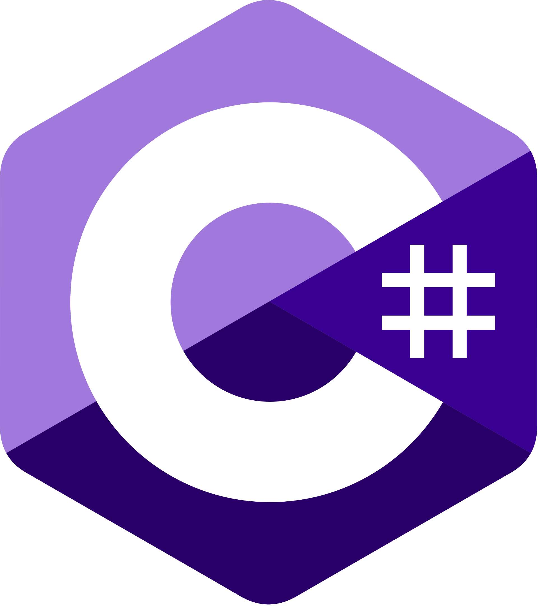
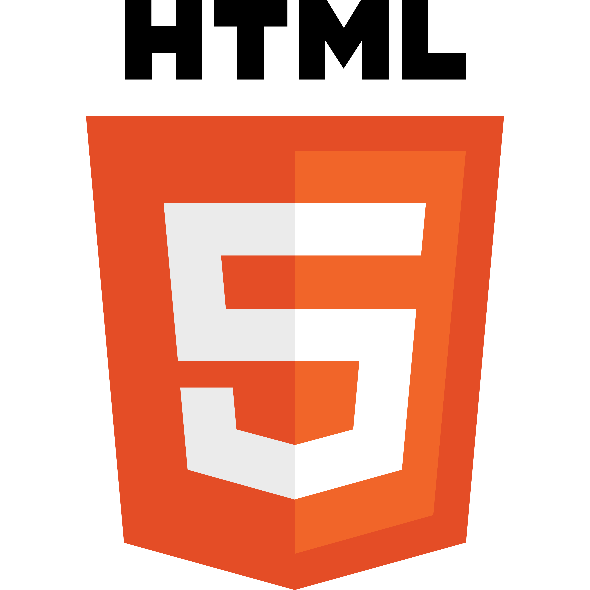
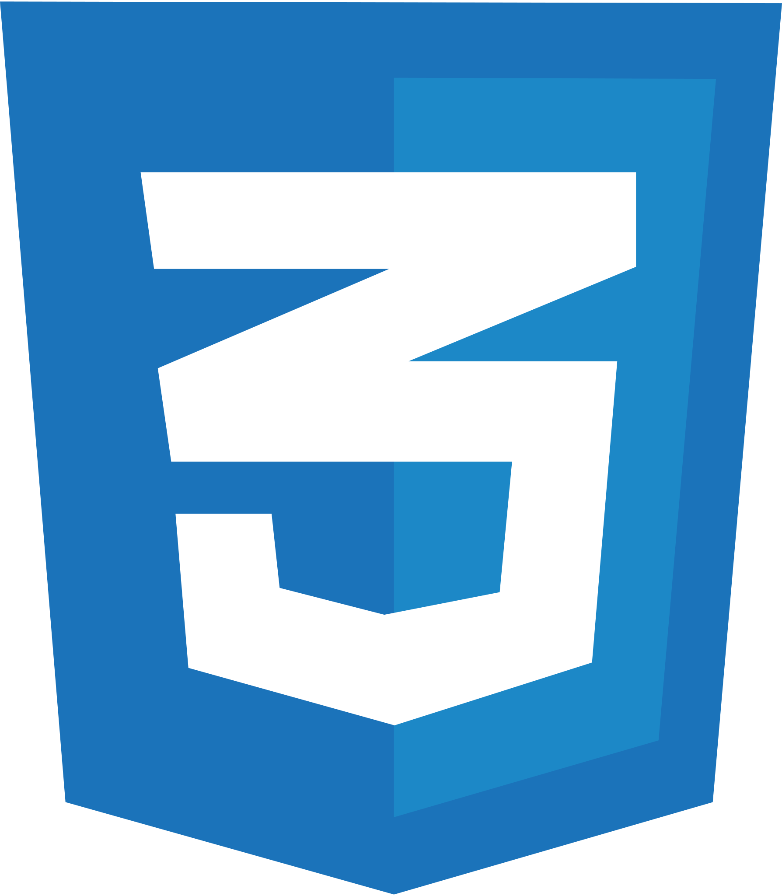
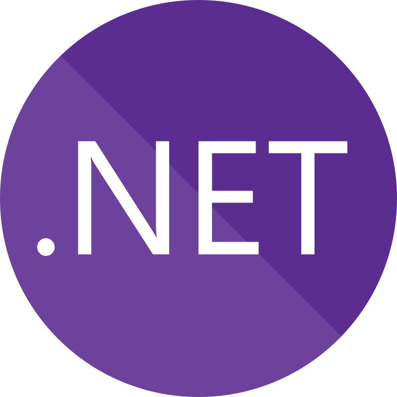
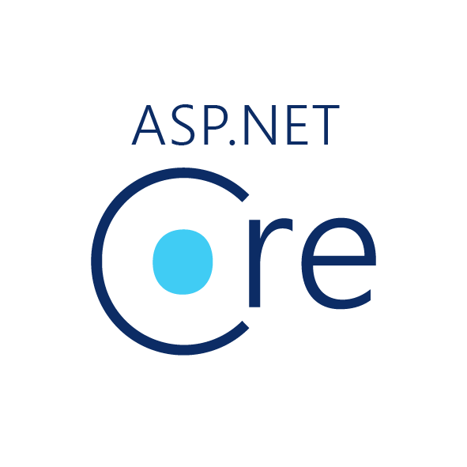
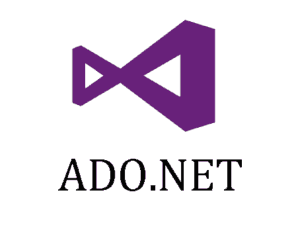
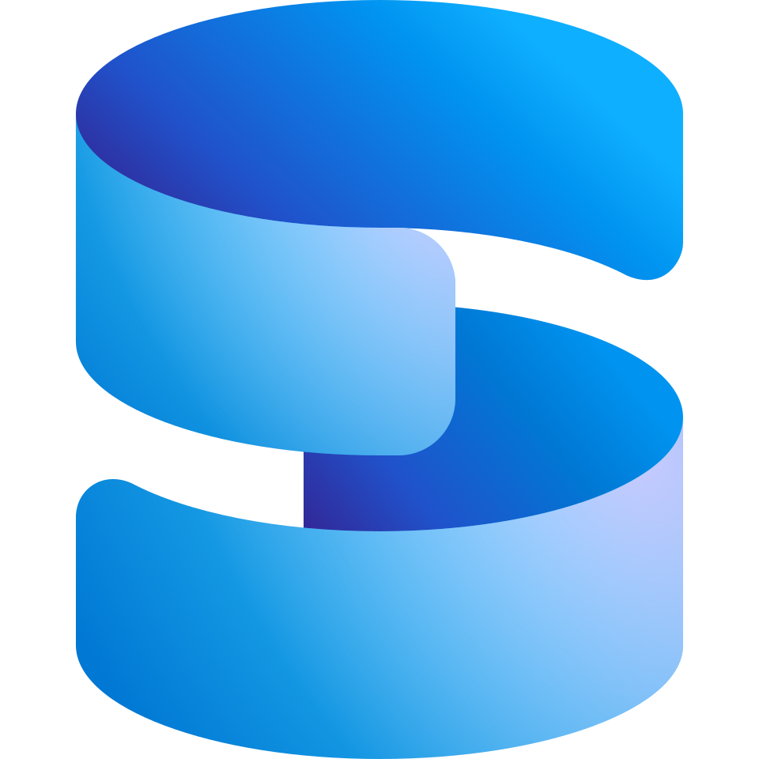
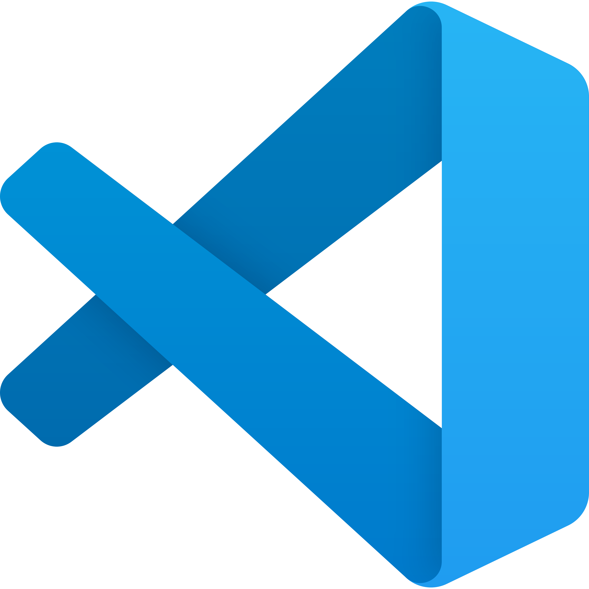
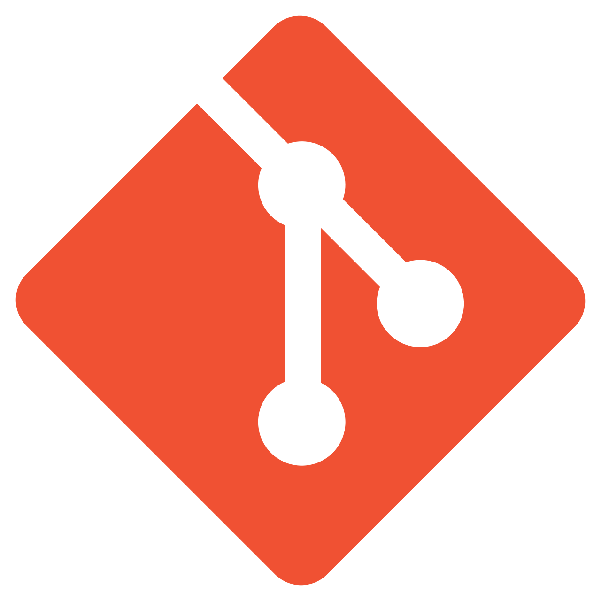

# Hi, I'm Kauan! 👋

I'm a Systems Analysis and Development student at UNINOVE, focused on Backend Development with C# and .NET.

I build REST APIs and database-driven applications, working with ASP.NET Core, Entity Framework Core, SQL Server, and ADO.NET. I'm continuously improving my skills through hands-on projects and looking for my first opportunity in software development.

## 🛠️ Technologies & Tools

### Languages

  
  
  
  

### Backend

  
  
  

**Technologies:** REST APIs, Entity Framework Core

### Databases

  

**Also used:** Oracle SQL

### Tools & Version Control

  
  
  

**Also used:** SQL Server Management Studio (SSMS)

## 🚀 Featured Projects

### SocialConnectApi

A functional REST API built with C# and ASP.NET Core, demonstrating API development and backend programming skills.

[View Repository](https://github.com/kauanbackend/SocialConnectApi)

### SistemaBiblioteca

A C# library management system built with SQL Server and ADO.NET, featuring book and user management, loan and return workflows, input validation, and a layered architecture with repositories and services.

[View Repository](https://github.com/kauanbackend/SistemaBiblioteca)

## 🎯 Current Goal

Seeking my first opportunity in software development, with a focus on Backend .NET, while continuing to strengthen my programming, API development, and database skills.

## 📫 Contact

- **GitHub:** [kauanbackend](https://github.com/kauanbackend)
- **LinkedIn:** [Kauan da Silva](https://linkedin.com/in/kauan-da-silva-93a88b3b5)
